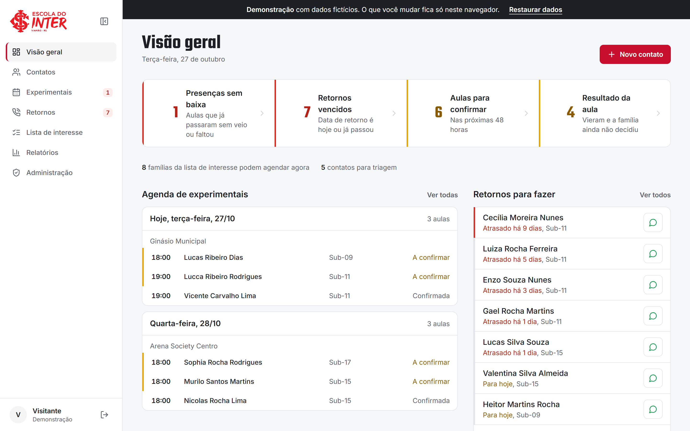
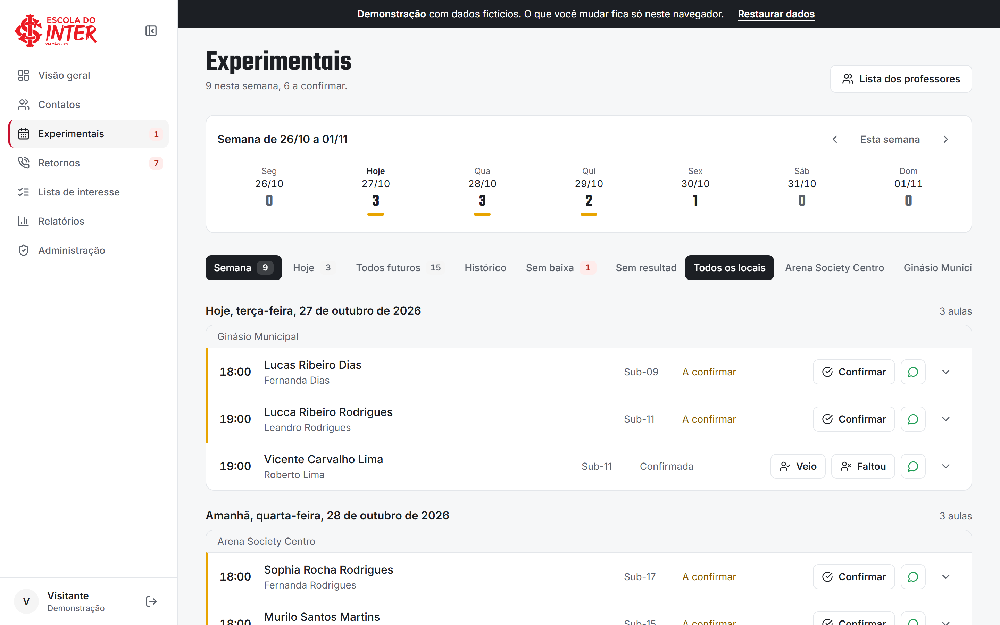
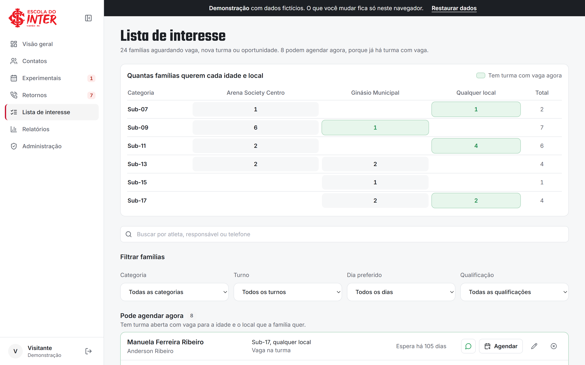
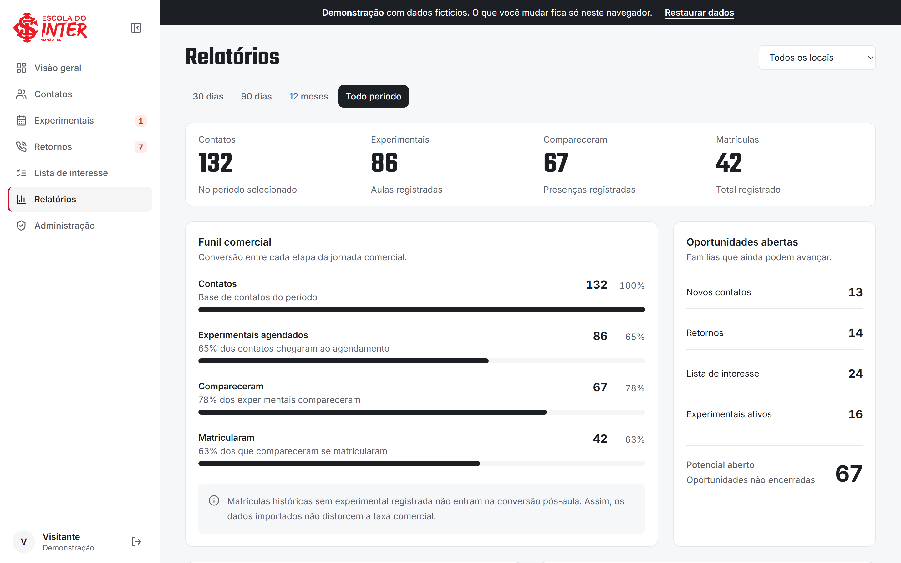
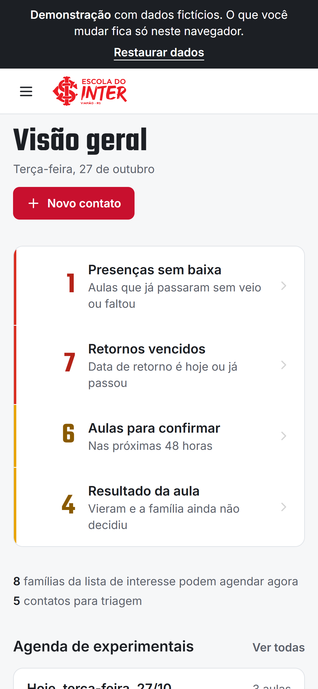
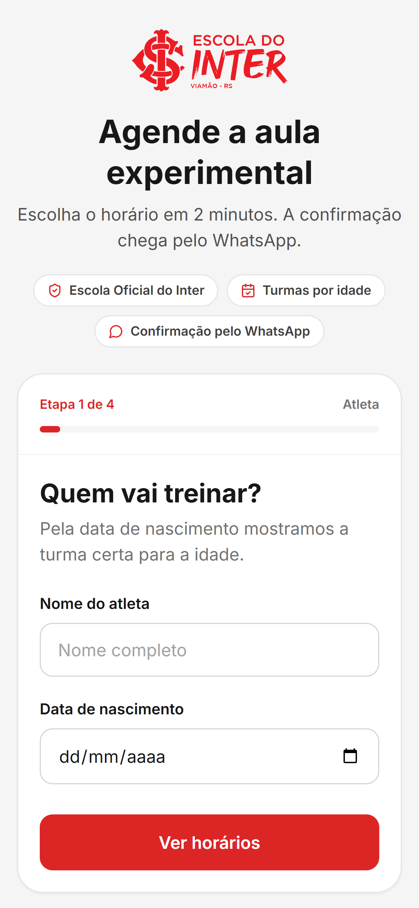

# CRM — Escola Oficial do Inter, Unidade Viamão

Sistema que leva a família do primeiro contato até a matrícula: os pais agendam a aula experimental pelo site, e a equipe acompanha confirmação, presença, retornos e matrícula num painel só.

**[Ver a demonstração →](https://crm-escola-demo.vercel.app)** (dados fictícios: pode clicar em tudo)



## O problema

A escola recebia os interessados pelo WhatsApp. Pais perguntavam horários, marcavam aula experimental e depois sumiam. Tudo dependia da memória de quem atendia: retornos esquecidos, aulas sem baixa de presença, nenhuma visão de onde faltava turma.

## O que o sistema faz

**Para os pais (site público)**
- Formulário de aula experimental em 4 passos, pensado para o celular. A categoria sai da data de nascimento, e só aparecem turmas abertas com vaga na data escolhida.
- Sem vaga ou sem turma para a idade, a família entra na lista de interesse com a preferência de local e turno.

**Para a equipe (painel `/admin`)**
- **Visão geral:** o que fazer hoje. Presenças sem baixa, retornos vencidos, aulas para confirmar e resultados pendentes, com a agenda da semana e o resultado do mês.
- **Experimentais:** a semana por dia e local. Confirmar, marcar veio ou faltou em um clique (com desfazer) e registrar o resultado.
- **Retornos:** até 3 tentativas em 14 dias, com mensagens prontas para o WhatsApp.
- **Lista de interesse:** quadro de demanda por idade e local, que mostra onde já há turma com vaga e onde vale abrir uma nova.
- **Contatos:** busca, filtros, triagem e ações em lote, com a lista guardando aba, filtros e página na URL.
- **Relatórios:** funil contato → experimental → presença → matrícula, origens e motivos de encerramento.
- **Administração:** turmas, horários, professores, categorias, locais e modalidades.

**Para os professores**
- Link do dia, sem login, para ver quem vem à aula experimental e marcar a presença pelo celular.

| Experimentais | Lista de interesse |
| --- | --- |
|  |  |

| Relatórios | No celular |
| --- | --- |
|  |   |

## Decisões técnicas

- **Segurança primeiro, porque os dados são de crianças.** O acesso é controlado no banco (Row Level Security). O site público não lê nenhuma tabela de contatos: o cadastro passa por uma função do banco que valida os dados, confere a vaga e grava tudo numa transação. Os professores só veem primeiro nome, idade e categoria.
- **Erros que o usuário entende.** Ações importantes têm "Desfazer". Ações em lote pedem confirmação com a quantidade. Mensagens técnicas do banco viram frases que dizem o que fazer.
- **Design pensado para o uso diário.** Um padrão visual próprio (cores por urgência só onde há algo a fazer, janelas acessíveis por teclado, menu recolhível), revisado com uma crítica de usabilidade e refeito tela a tela.
- **Demonstração sem risco.** A demo usa um cliente falso do banco que roda no navegador com dados inventados. Não existe conexão com os dados reais, e o build do site real nem inclui esse código.
- **Leve no celular.** As telas carregam sob demanda: o formulário público não baixa o código do painel.

## Stack

- **Front-end:** React 18, React Router, Tailwind CSS e Vite.
- **Banco de dados:** PostgreSQL, com Row Level Security para o controle de acesso e funções em PL/pgSQL para as regras de negócio (cadastro público em transação com trava de vaga, lista de presença do professor).
- **Autenticação:** login da equipe por e-mail e senha.
- **Infraestrutura:** PostgreSQL gerenciado pelo Supabase; deploy contínuo a cada merge.

## Rodar localmente

```bash
npm install

# Demonstração com dados fictícios (não precisa de banco)
VITE_DEMO=1 npx vite --port 5174    # http://localhost:5174

# Com o banco: crie um .env com VITE_SUPABASE_URL e VITE_SUPABASE_PUBLISHABLE_KEY
npm run dev                          # http://localhost:5173
npm run build
```

## Estrutura

```
src/
  pages/            telas públicas (landing, formulário, lista do professor)
  components/public formulário de aula experimental
  admin/            painel: layout, componentes de interface, telas e cadastros
  services/         todo acesso ao banco
  constants/        status, rótulos e regras do funil
  demo/             modo demonstração: cliente falso + dados fictícios
supabase/           migrations
```

## Documentação

- [CLAUDE.md](CLAUDE.md): regras do projeto, padrão visual e histórico de mudanças.
- [PRODUCT.md](PRODUCT.md): usuários, propósito e contexto do produto.

---

Desenvolvido por Eduardo Ribeiro para a Escola Oficial do Inter, Unidade Viamão.
